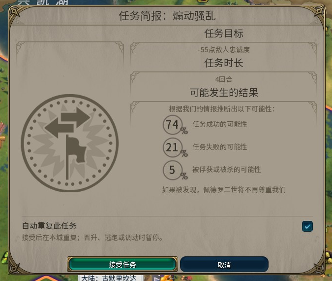

# Spy Repeat for Civilization VI

[简体中文](README.md) · [Issues](https://github.com/civs6-mods/SpyRepeat/issues)

Repeat manually assigned spy missions and counterspy duties without selecting the same task every few turns. Each spy has an independent switch. Repeat pauses when promotions, escape, travel or invalid targets need your attention.

**0.2.4 · single-player preview.** The source is public; this mod has not been published to Steam Workshop. Uses Lua/XML and native game UI assets only, with no DLL changes.



## Install

1. Download the repository using **Code → Download ZIP**, or clone it.
2. Exit the game. Copy the repository's **`mod` folder** into Civilization VI's `Mods` directory and rename the copied folder **`SpyRepeat`**.
3. Check that the manifest is at `Mods/SpyRepeat/SpyRepeat.modinfo`.
4. Enable **Spy Repeat** under Additional Content → Mods.

On Windows, the usual location is `Documents/My Games/Sid Meier's Civilization VI/Mods`. Start a new single-player game for initial testing. Adding the mod to a save that did not previously use it is unverified. Installation does not require Python or Node.js; these are development tools. Generated ZIP files are not committed to this repository.

## Use

- **New offensive assignment:** send the spy to a city first. After arrival, choose a mission, check Repeat in the native briefing, then accept. Cancelling discards the draft.
- **Counterspy:** check Repeat counterspy before selecting a district. Repeat keeps the same city and district.
- **Current mission:** select the spy and click the unit action using the native Auto Explore icon. Gold means enabled; white means disabled. Its tooltip explains the next click and current status.
- **Overview:** use the native espionage overview to inspect, stop or resume each spy's repeat setting.

Destination mission cards are previews. The repeat checkbox appears in the actual briefing or counterspy district chooser. Disabling repeat preserves the current mission and stops subsequent automatic assignments.

## Behavior and compatibility

The mod remembers your chosen mission and target. It does not choose cities, promotions or escape routes, and does not dismiss mission results. Gain Sources is a preparation action and cannot be repeated indefinitely. Handle a pause and explicitly resume; changing cities requires a new assignment. Settings are saved with the game, with at most one automatic dispatch per spy per turn.

The target setup is Gathering Storm with Harmony in Diversity. Partial real-game checks cover one Chinese HD / Better Espionage Screen collection. Other collections, UI scales and languages remain unverified. Multiplayer and hotseat are unsupported. Mods replacing the same espionage UI scripts may conflict; avoid managing a spy with two automation mods at once.

See the [verification report](docs/VERIFICATION.zh-CN.md) and [detailed behavior](docs/BEHAVIOR.zh-CN.md), currently in Chinese. Offline regression results do not establish engine or UI compatibility.

## Development

Requires Python 3.10+ and Node.js 20+. From the repository root:

```sh
npm ci
python scripts/verify.py
python scripts/test.py
python scripts/package.py
```

The ZIP is written to `dist/SpyRepeat-0.2.4.zip`. `mod/` contains the installable files; `tests/` contains offline regressions; `docs/` contains rules and gameplay screenshots; `workshop/` contains unpublished listing drafts. GitHub Actions runs verification, tests and packaging. Update the release manifest hashes when intentionally changing runtime files for a new version.

## Contributing and license

Report bugs through [Issues](https://github.com/civs6-mods/SpyRepeat/issues), including game/DLC/HD versions, active mods, reproduction steps and relevant log errors. Translation, tests and Lua/UI improvements are welcome; see [Contributing](CONTRIBUTING.md).

Original code is [MIT licensed](LICENSE). Civilization VI assets and screenshots remain the property of their respective rights holders. This is not an official Firaxis, 2K, Aspyr or HD release.
