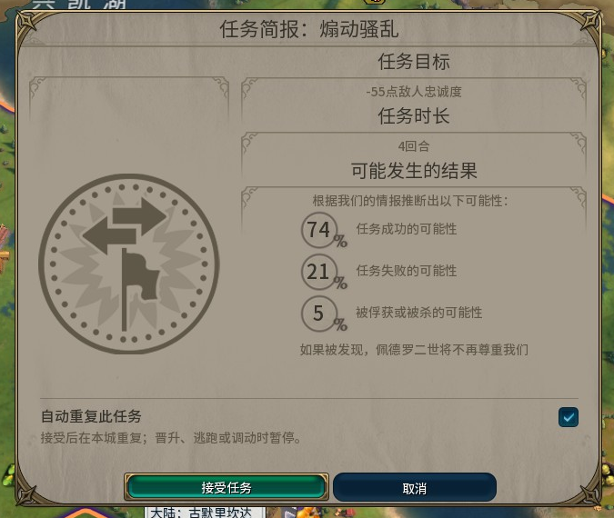
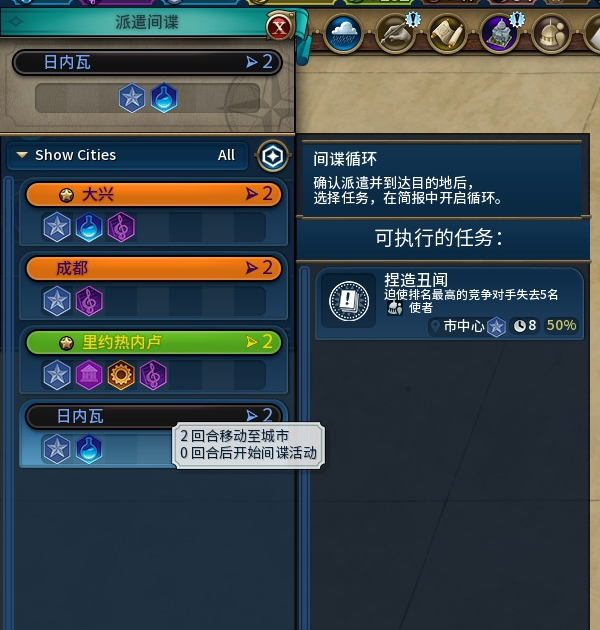

# 间谍任务循环 · Spy Repeat

[English](README.en.md) · [问题反馈](https://github.com/civs6-mods/SpyRepeat/issues) · [验证记录](docs/VERIFICATION.zh-CN.md)

为《文明 VI》的间谍重复执行已安排的任务，减少每隔几回合重新点选的操作。每名间谍独立控制，支持进攻任务和指定区域的反间谍续期；需要处理晋升、逃跑或目标变化时暂停。

**当前版本：0.2.4，单机预览版。源码已公开，尚未发布到 Steam 创意工坊。** 只使用 Lua/XML 和游戏原生 UI 资源，不修改 DLL。



## 安装

1. 点击本页 **Code → Download ZIP** 并解压，或克隆本仓库。
2. 退出游戏，将仓库中的 **`mod` 文件夹**复制到游戏的 `Mods` 目录，并将复制后的文件夹命名为 **`SpyRepeat`**。
3. 确认文件位于 `Mods/SpyRepeat/SpyRepeat.modinfo`，不要再套一层项目目录。
4. 启动游戏，在「额外内容 → 模组」启用「间谍任务循环 / Spy Repeat」。

Windows 的常见位置是 `文档/My Games/Sid Meier's Civilization VI/Mods`。首次验证建议开单机新局；把 Mod 后加到此前未启用它的存档，尚未验证。

安装不需要 Python 或 Node.js；开发和打包才需要这些工具。仓库不提交 `dist/` 安装包，也可按下方步骤自行生成 ZIP。

## 使用

| 场景 | 操作 |
| --- | --- |
| 新间谍出国 | 先确认派遣。到达后选择任务，在任务简报中勾选「自动重复此任务」，再接受任务 |
| 本国反间谍 | 在选区页勾选「自动重复反间谍」，再选择要保护的区域 |
| 已在执行任务 | 选中间谍，点击单位操作栏的循环按钮，直接开启、关闭或恢复 |
| 查看所有间谍 | 打开原生间谍总览，查看各自状态并关闭或恢复循环 |

**派遣城市时的任务卡片只是预览。** 循环开关在到达后的任务简报或反间谍选区页。任务简报的勾选在接受任务后才生效，取消不会保存。

单位按钮使用原生自动探索图标：金色表示开启，白色表示关闭，悬浮可查看本次点击操作、任务和暂停原因。关闭循环只停止后续续派，当前任务继续执行。



## 规则与兼容性

- 记住手动安排的任务和目标，不自动选择城市、晋升或逃跑路线。获取来源属于准备行动，不提供无限重复。
- 遇到晋升、逃跑、调动、目标失效或离开地图时暂停；处理后由玩家恢复。任务结果弹窗仍由游戏管理。
- 同城手动更换可重复任务会更新循环目标；主动调往其他城市后需要重新安排。
- 设置随存档保存，每名间谍每回合最多提交一次自动续派。
- 目标环境为《风云变幻》与《和而不同》。目前只在一套中文 HD / Better Espionage Screen 组合中完成部分实机验证，其他组合、语言及 UI 比例尚未验证。
- 仅支持单机，多人和热座不支持。其他 Mod 替换同一间谍 UI 脚本时可能冲突；不要让两个自动化 Mod 同时管理同一个间谍。

详细说明见[循环规则](docs/BEHAVIOR.zh-CN.md)。[验证记录](docs/VERIFICATION.zh-CN.md)区分了实机检查与离线模拟，不能视为全部场景均已通过。

## 开发与打包

需要 Python 3.10+ 和 Node.js 20+，在仓库根目录运行：

```sh
npm ci
python scripts/verify.py
python scripts/test.py
python scripts/package.py
```

生成 `dist/SpyRepeat-0.2.4.zip`，解压后的 `SpyRepeat` 文件夹可直接放入游戏 `Mods` 目录。

| 目录 | 内容 |
| --- | --- |
| `mod/` | 完整可安装的 Lua/XML 源码 |
| `tests/` | 执行实际源码的离线回归 |
| `scripts/` | 文件校验、测试和打包 |
| `docs/` | 规则、实机验收和截图 |
| `workshop/` | 尚未发布的工坊介绍与封面 |

`release-manifest.json` 记录已验收版本的文件哈希；有意修改运行文件后，需随版本更新清单。GitHub Actions 自动运行校验、回归与打包。

## 反馈与参与

请通过 [Issues](https://github.com/civs6-mods/SpyRepeat/issues) 提供游戏/DLC/HD 版本、启用的 Mod、复现步骤及相关 `Lua.log` / `Modding.log` 错误。欢迎提交翻译、测试和 Lua/UI 改进，详见[参与说明](CONTRIBUTING.md)。

原创代码采用 [MIT](LICENSE)。游戏素材和截图的权利归各自权利人。本项目不是 Firaxis、2K、Aspyr 或 HD 制作组的官方作品。
