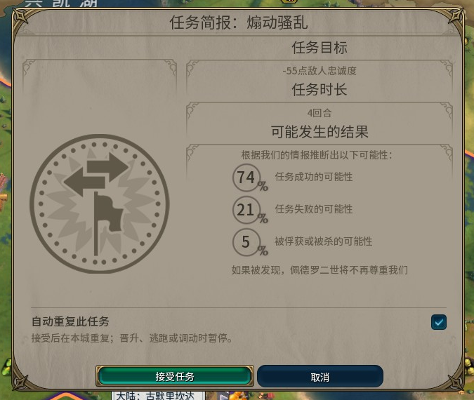

# SpyRepeat 界面验收

## 0.2.4：任务简报分隔与单行说明

2026-11-16，在同一中文 HD / DX12、3840×2160 环境中重新启动游戏读档检查。循环设置上方改用可实际绘制的 592×1 灰褐色分割线，与标题和说明左边缘对齐；副说明去掉强制换行并缩短文案。

实机测量：分割线、标题及说明左边缘 x 均为 1624，中文说明高度 14。在同一标签中临时填入英文说明也为 14，恢复后保持中文；这不代表完整英文环境已经验证。按钮无重叠或裁切。

本轮通过游戏原生简报事件预览煽动骚乱，检查布局后取消，没有接受新任务；原情报站任务、开启状态和第 190 回合均保留。源码、已安装目录及 0.2.4 ZIP 的 11 个运行文件哈希一致；离线回归通过，游戏日志无 Lua 运行错误。

## 0.2.3：新间谍入口与原生图标

2026-11-16，在用户中文 HD / Better Espionage Screen 组合、DX12、3840×2160、当前 UI 比例下检查。未上传工坊。

## 本轮修复

- 去掉单位按钮里的「∞ 自动」组合标签。固定使用游戏原生 `ICON_UNITOPERATION_AUTO_EXPLORE`（齿轮中的循环箭头），38×38 居中；开启金色，关闭白色。保留一键关闭/恢复和悬浮说明，不再打开独立详情面板，也不再切成带叉的停止自动化图标。
- 新间谍的派遣目的地页面只预览任务，游戏原脚本会禁用此处任务卡片。本轮在预览上方说明：确认派遣、到达目的地、选择任务，再在任务简报中开启循环。
- 外国城市的实际任务列表也显示入口说明。本国反间谍选区继续提供可点击的循环勾选区。
- 标题和说明左边缘一致，反间谍复选框靠右，原生任务列表为说明区预留高度。

## 实机发现并修复的高度问题

第一次检查发现确认派遣按钮被挤出屏幕。原控件采用相对父级高度，`SetSizeY` 会在后续原生布局时被覆盖。已改为读取并缩减 `GetParentRelativeSizeY`，正常退出、同步安装目录、重新启动读档后复验。

当前 BES 组合：派遣列表相对高度为 -339，实际任务列表为 -208；原生面板从 y=6 下移到 y=88。三个模式各连续刷新 12 次，偏移及相对高度均不累积。截图确认派遣页底部的确认、取消按钮完整可见。

## 本轮已验证

| 场景 | 结果 |
| --- | --- |
| 新间谍选择日内瓦 | 入口说明可见，原生任务卡片和底部按钮完整 |
| 外国城市实际任务列表 | 入口说明可见，任务仍可点击 |
| 点击原生「煽动骚乱」任务 | 实际任务简报显示「自动重复此任务」，点击标题区域可勾选 |
| 勾选后取消任务 | 注册表没有新增记录，间谍原生任务仍为 -1 |
| 大兴反间谍选区 | 循环勾选区显示，说明和标题对齐，区域列表无遮挡 |
| 贵仁循环开关 | 一键关闭只停后续循环，情报站任务仍为操作 43；再次点击恢复，未出现独立面板 |
| 正常重启读档 | 修正后的已安装源码生效，新间谍长缨仍在 |
| 清理与交接 | 临时间谍已清理；原三名间谍保留，回合仍为 190，长缨尚未接任务 |

任务简报内标题与说明的屏幕 x 坐标均为 1624；反间谍及外国任务列表的两者 x 坐标均为 18；派遣预览两者均为 313。说明没有超出自己的区块。

外国任务界面使用临时新建于里约热内卢的间谍 1638423 测试，以免推进用户世界回合。这验证了驻城新间谍的 UI 路径，**不是完成两回合真实旅行的测试**。取消后已仅删除该临时单位。用户间谍 983054、1507349、1572886 均保留，贵仁原开启状态已恢复；最终停在长缨的反间谍选区页。

## 截图与检查

- [派遣预览](screenshots/destination.png) / [完整画面](screenshots/destination-full.jpg)
- [任务列表](screenshots/mission-list.png) / [任务简报](screenshots/mission-briefing.png)
- [反间谍](screenshots/counterspy.png)
- [循环开启](screenshots/native-icon-on.png) / [循环关闭](screenshots/native-icon-off.png)

离线回归见 `tests/`，可按仓库 README 独立运行。源码、原本地 0.2.3 安装包与拆分后的 mod 文件逐项一致，哈希记于根目录 release-manifest.json。

本轮未重新完成跨回合续派、真实旅行、晋升、逃跑等全量实机验收。其他分辨率、UI 比例、语言、Mod 组合和多人游戏仍未验证。截图包含游戏素材，相关权利归其权利人。
